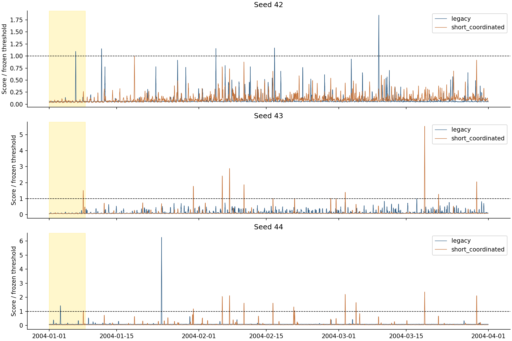
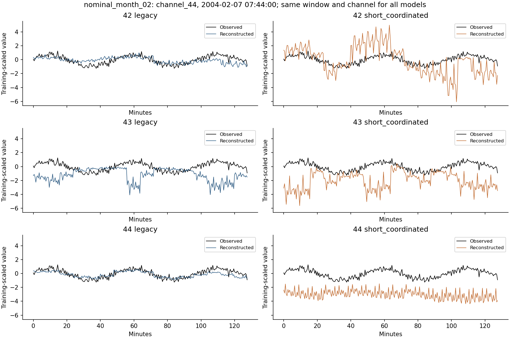
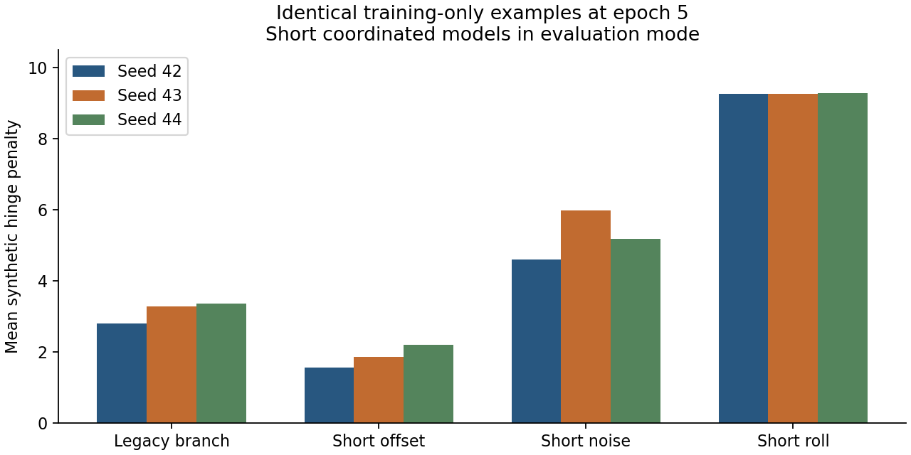

# Why the short coordinated pilot struggles in 2004

## Conclusion

The candidate does not consistently separate the calibration event from normal
behavior. Its false alarms involve several input channels, and selected nominal
examples show large reconstruction offsets or oscillations. A training-only
synthetic probe identifies a specific hypothesis: very short temporal rolls are
almost indistinguishable from their normal counterparts to these models, while
the objective still demands much higher error on them.

The next bounded experiment should remove temporal rolls **only from the short
branch**, retaining short offsets/noise and the unchanged legacy branch. This is
a proposed ablation, not a proven remedy or a newly trained model. Keep the
existing baseline and frozen rules. No assessment arrays were read in this work.

## What was checked

- All six saved calibration-selected 2004 checkpoints: legacy and short
  coordinated, seeds 42/43/44. Features remain channels 40–47.
- One identical probe of 1,024 globally nominal windows, 256 evenly spaced
  eligible windows per training year, 2000–2003.
- Full January–March 2004 calibration: 262,080 samples, 8,183 length-256
  scoring windows at stride 32. No April–December or 2007–2013 inference.
- Original training histories, checkpoint selection and saved candidate grids.
- A separate fixed-epoch-five probe on 512 equally distributed nominal training
  windows, with identical synthetic corruptions applied to all six models.

Training CSV SHA256 matched the recorded golden hash before and after loading.
Annotation and inference-source hashes matched the saved protocols. All model
scalers were exactly equal, source hashes remained stable, and each original
25,000-window sample passed the wholly nominal/bounded training checks. CPU
inference used two threads and batch size 64 because CUDA was unavailable here.

## Calibration already shows the problem

The single positive event ID is `id_12`. Its system interval within calibration
is January 1 through January 8 at 12:00; this is clipped to the calibration
boundary, not a claim about the original event start.

| Seed | Arm | Selected epoch | Saved calibration F0.5 | TP / FP / FN |
|---|---|---:|---:|---|
| 42 | Legacy | 2 | 0.237582 | 1 / 4 / 0 |
| 42 | Short coordinated | 1 | 0.000000 | 0 / 0 / 1 |
| 43 | Legacy | 1 | 0.000000 | 0 / 0 / 1 |
| 43 | Short coordinated | 5 | 0.110041 | 1 / 10 / 0 |
| 44 | Legacy | 4 | 0.554701 | 1 / 1 / 0 |
| 44 | Short coordinated | 5 | 0.101016 | 1 / 11 / 0 |

The saved candidate grids at these selected checkpoints show that every
admissible detecting rule for candidate seeds 43/44 incurs at least 10/11 false
events, respectively. This is within the recorded grid and 1% predicted-fraction
policy, not a claim about every possible threshold. For candidate seed42 there
is no detecting candidate within that policy. Do not lower thresholds to chase
the event: a previous grid/cap change already failed development assessment.

All six CPU diagnoses reproduce saved TP/FP/FN. Four also reproduce the saved
scalar metrics within 1e-6. Candidate seed43 and legacy seed44 have 960 extra
nominal alarm seconds on CPU, with F0.5 differences -0.0000144631 and
-0.0000657387. Each has a 32-sample nominal plateau just above its frozen
threshold (6 and 3 float32 spacings, respectively). Removing that plateau in a
**diagnostic counterfactual** reproduces the saved scalar metrics. Original GPU
calibration score arrays were not retained, so exact mask agreement/device
causation is not proved. No threshold, saved prediction or official result was
changed; fresh CPU outputs are explicitly labeled.



## Normal reconstruction and channel contributions

The candidate's logged epoch-five normal MSE is higher by 16.9%, 25.4% and 26.2%
for seeds42/43/44. It is higher at every matched logged epoch. These are
training-mode averages over a changing model, not final checkpoint eval-mode MSE.
On the separate identical final-epoch eval-mode probe, normal MSE is slightly
lower for candidate seed42 (0.1682 versus 0.1787), but higher for seed43
(0.2159 versus 0.1320) and seed44 (0.2282 versus 0.1091). Avoid saying every
normal input becomes worse.

At the selected checkpoints, typical errors and extreme errors tell different
stories. In February, seed44 candidate median maximum-channel window error is
0.1435 versus legacy0.1709, but its 99th percentile is5.9305 versus0.2092.
Rare large errors persist despite a low typical error. This is a descriptive
selected-checkpoint comparison (candidate epoch5 versus legacy epoch4), not an
isolated same-epoch causal effect. Sampled training tails are also not exact
full-training tails.

Candidate seed43's ten calibration false events are dominated by channels44
(five),41(two),43(two),45(one). Seed44's eleven are dominated by41(four),42(three),
46(two),43(one),44(one). There is no single consistent input to discard.
Dominant-channel attribution identifies the largest residual contribution, not
the physical cause of an alarm.



Examples use one high-error nominal window per calibration month, selected by
mean within-model error rank across all six models. Each plot uses identical
observations and one common channel for every arm. They illustrate failure
modes, not an unbiased estimate of average reconstruction quality. The February
example is channel44 at February7 07:44; the candidate models show offsets or
oscillations on this annotated-nominal window. January/March and one annotated
event example are retained in the evidence folder.

## A specific weakness in the synthetic training examples

The fixed probe used final epoch-five checkpoints, eval mode, batch64 and a
fixed corruption RNG seed29092026. There were265 legacy-branch examples and247
short examples:79 offsets,88 noise bursts and80 rolls. Every model received the
same inputs and corruptions. This is not a replay of dropout-active training.

For the80 short rolls, the median ratio of corrupted-window MSE to its paired
normal-window MSE is between0.9999 and1.0004 across the six models: essentially
unchanged. In contrast, the training objective targets a corrupted error at least
10 times the detached **batch mean** normal error. Those two denominators differ;
the paired ratio is a diagnostic, while the recorded hinge uses the real batch
denominator.

All short-roll examples retain a positive hinge penalty in the three legacy
models. The candidate models retain it in100%,97.5%,98.75% of short-roll examples.
Their mean roll penalty is9.25–9.28, versus1.56–2.19 for short offsets and
4.59–5.99 for short noise. Two of80rolls are exact no-ops; most change values but
remain weak perturbations. Median whole-window injected energy is0.000720 for
rolls, versus0.023795 for short noise and0.047991 for short offsets.



This supports investigating weak short-roll targets. It does **not** prove they
caused the calibration false alarms: the current mixture also changes support,
scale and corruption distribution. Do not silently alter the objective or claim
an F0.5 gain from this diagnostic.

## Next experiment specification

One focused candidate: 50% original legacy generator, 50% short offset/noise
generator with temporal rolls removed from the short branch only. Retain
duration1–10samples, channel count1–8, scaling, architecture, input channels,
training loss, scoring and selection policy. Equal-probability offset/noise is
a design choice, not a fitted real-event frequency. Preserve existing modes and
write new output directories.

Use the same five-epoch/25,000-window budget, three seeds and chronological
folds2003/04/05. Compare with both prior generator designs under documented
matched conditions, including nominal MSE, synthetic separation, calibration
and both assessment scopes. Do not select a seed or year retrospectively.
These periods are already-inspected development data; any eventual promotion
requires consistency and an explicitly agreed final evaluation plan. No new
training or ablation implementation occurred in this diagnostic turn.

## Reproduction and evidence

```bash
PYTHONPATH=. python scripts/research/diagnose_augmentation_2004.py \
  --output NEW_DIAGNOSTIC_DIRECTORY --device cpu --batch-size 64 --threads 2
PYTHONPATH=. python scripts/research/probe_short_augmentation_objective.py \
  --diagnostic NEW_DIAGNOSTIC_DIRECTORY --output NEW_PROBE_DIRECTORY
```

Original outputs: `results_longrun/diagnostics/augmentation_2004_multiseed_v1`
and `results_longrun/diagnostics/augmentation_objective_probe_2004_v1`.
Compact tables, plots and provenance are in
[the evidence folder](tables/augmentation-2004-diagnosis-2026-09-29/).
Both inference workflows completed; nominal-window exclusion/quantile checks and
the five existing augmentation regression tests passed. No production model,
training defaults or metric implementation changed. No GitHub push performed.
