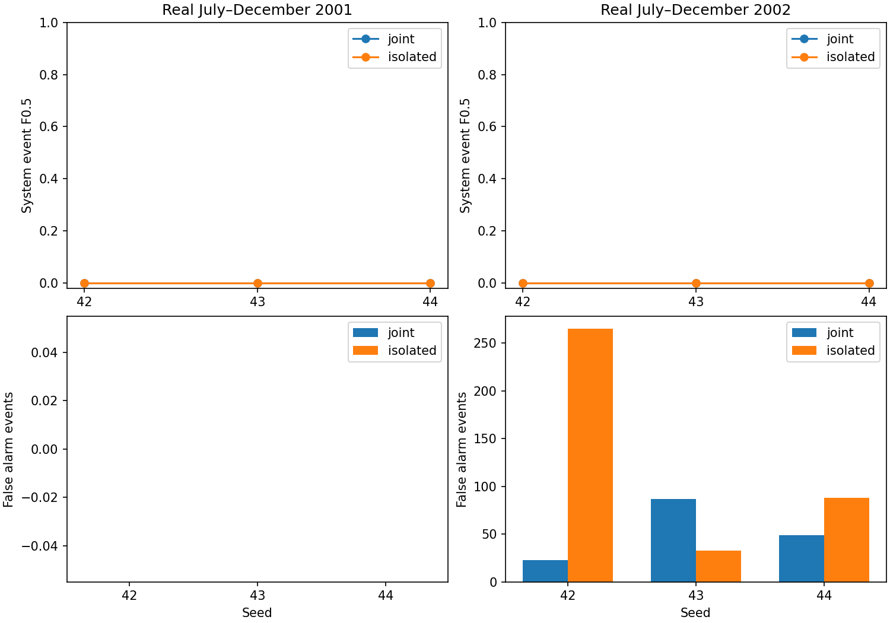

# Channel-isolation comparison: verified results

All six candidate runs completed. Primary policy: calibration-selected checkpoints.
Control and candidate use loss weight 1, the same real periods and all three seeds.
Both models have 1,333,392 parameters; diagonal channel attention changes functional capacity.
No level centering or channel removal was applied.

| Fold (Jul–Dec) | Arm | Scope | Mean F0.5 | SD | Mean FP | Mean recall | Mean nominal false-alarm fraction |
|---|---|---|---:|---:|---:|---:|---:|
| 2001 | isolated | input_channels_40_47 | 0.000000 | 0.000000 | 0.000 | 0.000000 | 0.000000 |
| 2001 | isolated | system_all_channels | 0.000000 | 0.000000 | 0.000 | 0.000000 | 0.000000 |
| 2001 | joint | input_channels_40_47 | 0.000000 | 0.000000 | 0.000 | 0.000000 | 0.000000 |
| 2001 | joint | system_all_channels | 0.000000 | 0.000000 | 0.000 | 0.000000 | 0.000000 |
| 2002 | isolated | input_channels_40_47 | 0.000000 | 0.000000 | 128.667 | 0.000000 | 0.320172 |
| 2002 | isolated | system_all_channels | 0.000000 | 0.000000 | 128.667 | 0.000000 | 0.320172 |
| 2002 | joint | input_channels_40_47 | 0.000000 | 0.000000 | 53.000 | 0.000000 | 0.447318 |
| 2002 | joint | system_all_channels | 0.000000 | 0.000000 | 53.000 | 0.000000 | 0.447318 |

**Predeclared advancement gate: failed.**
Gate: higher mean system F0.5 in both folds without increased mean false-event counts.
The main full-period baseline is unchanged. No automatic promotion or outer-period run.
Fixed-epoch-five results are secondary and were not selected after viewing validation.
Internal periods were previously inspected for development; these are not untouched tests.

## Verification

92 tests passed before launch, including cross-channel output/gradient isolation and identical seeded parameters.
Verified 30 calibration epochs, 24 candidate metric rows, both arms’ artifact manifests, paired windows/scalers/timestamps and 60 loss decompositions.

[Protocol](channel-isolation-plan-2026-10-08.md).
[All primary rows](tables/channel-isolation-results-2026-10-08/results.csv).
[Verification](tables/channel-isolation-results-2026-10-08/verification.json).

**Replay warning:** instantiate ChannelIsolatedAE for candidate checkpoints; matching tensor keys do not make them joint-model checkpoints.
