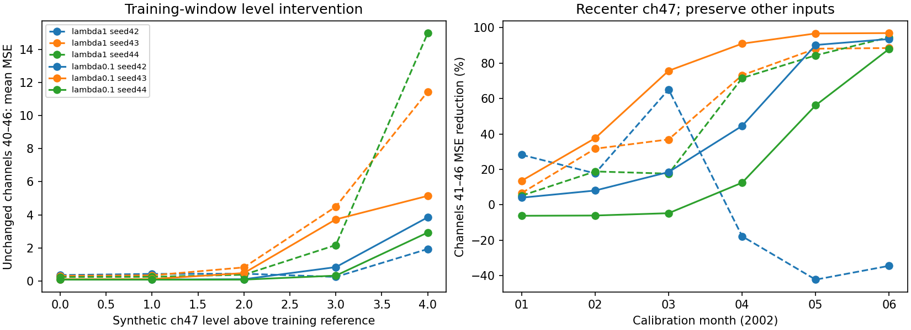

# Frozen-model intervention: channel 47 affects other reconstructions

## Main finding

Channel 47's level can causally change the saved model's reconstruction of other
channels whose inputs are held fixed. This is a model-sensitivity result, not a
causal claim about spacecraft hardware and not an improvement in F0.5.

Six frozen 2002-fold models were tested: original artificial-anomaly weight 1 and
reduced weight 0.1, each with seeds 42, 43 and 44. Only training and calibration
telemetry before July 2002 was loaded. No validation or outer assessment was used
in this probe. The hypothesis was motivated by previously inspected validation;
that development history still needs to be disclosed.

## Intervention design

Use 64 evenly spaced, wholly nominal, month-contained windows per month from
January 2000 to June 2002: 1,920 windows per model. Each has 256 samples.
For each channel, compute a reference as the median of per-window scaled means
in the 2000–2001 training sample only.

Compare three inputs to each saved model:

1. Original window.
2. Shift only channel 47 by a constant so its window mean equals its training reference.
3. Shift only channel 40 to its own training reference as a comparison intervention.

The shift preserves the changed channel's within-window differences. Other
channels remain byte-for-byte identical. Channels 41–46 are unchanged in both
interventions, so compare their mean reconstruction MSE. No scaler fitting,
model fitting, threshold choice, postprocessing change or event scoring occurs.
Synthetic interventions are not reported as real-data benchmark results.

## June 2002: errors on unchanged channels 41–46

| Loss weight | Seed | Original MSE | Recenter ch47 MSE | Reduction | Recenter ch40 reduction |
|---|---:|---:|---:|---:|---:|
| 1 | 42 | 0.343 | 0.461 | -34.4% | -9.2% |
| 1 | 43 | 7.437 | 0.858 | 88.5% | -0.2% |
| 1 | 44 | 6.187 | 0.336 | 94.6% | -4.9% |
| 0.1 | 42 | 2.245 | 0.145 | 93.5% | 0.3% |
| 0.1 | 43 | 5.086 | 0.158 | 96.9% | -3.8% |
| 0.1 | 44 | 0.911 | 0.110 | 88.0% | -0.9% |

Positive reduction means less error; negative means worse. The original-weight
seed-42 exception matters: level adjustment does not help every model in every
period. Recentring channel 40 is not a dose-matched negative control; its original
level deviation differs from channel 47's. It is a comparison, not proof that
channel 47 is uniquely capable of causing interference.

## Controlled level sweep on training windows

On the same 128 nominal training windows, set channel 47's mean to the training
reference plus 0, 1, 2, 3 or 4 scaled units. Preserve every other input and its
within-window waveform. At level +4, mean MSE on unchanged channels 40–46 rises
in all six models:

| Weight | Seed | At reference level | At reference +4 |
|---|---:|---:|---:|
| 1 | 42 | 0.353 | 1.930 |
| 1 | 43 | 0.303 | 11.457 |
| 1 | 44 | 0.233 | 15.000 |
| 0.1 | 42 | 0.079 | 3.849 |
| 0.1 | 43 | 0.097 | 5.145 |
| 0.1 | 44 | 0.077 | 2.927 |

This intervention establishes cross-channel sensitivity of these trained models.
It does not show that every real false alarm has the same cause, and it does not
measure anomaly recall. Interventions may create input combinations outside the
training distribution. No clipping is applied after the diagnostic shifts.

## Why we are not simply centering every window

Subtracting a window's mean removes a constant offset whether that offset is
normal or anomalous. A sustained anomaly that fills the window can therefore
disappear. Reducing normal MSE alone is not a valid criterion for adoption.

The earlier carried-forward residual **forecaster** already failed its 2003
comparison: F0.5 fell from 0.086696 to 0.070614, with 79 to 82 false events.
That model forecasts future deviations from the last context value; this probe
uses interventions on a frozen reconstruction AE. They answer different
questions, but the earlier negative result prevents claiming level handling is
a guaranteed fix. See [residual experiment](residual-transformer.md).

## Decision and next controlled work

Keep the existing full-period reference and all eight input channels. Do not
promote a centered score or choose a threshold from this probe. No new training
was launched.

The next design must preserve absolute-level evidence while limiting the effect
of one channel's level on other outputs. A bounded comparison of channel-isolated
reconstruction against the current joint reconstruction is a better-defined
candidate than another loss-weight sweep or blind mean subtraction. Before any
training, specify its architecture and capacity differences, fixed real-data
splits, budget, seed pairing and calibration-only selection. Its purpose would
be to test cross-channel interference, not assume that channel relationships
are useless. Same real assessment periods and both event scopes remain required.

## Reproducibility

- Golden prepared CSV checksum verified before and after execution.
- Source hashes and all six completed-run manifests verified; checkpoints unchanged.
- Two intervention tests verify target means, waveform preservation, independent
  per-window offsets, and unchanged other channels/original inputs.
- Full thesis suite: 89 tests passed.
- Full artifacts: `results_longrun/diagnostics/channel_level_coupling_v1`.
- [Monthly interventions](tables/channel-level-coupling-2026-10-03/monthly_interventions.csv).
- [Unchanged-channel summary](tables/channel-level-coupling-2026-10-03/unchanged_outputs_summary.csv).
- [Training level sweep](tables/channel-level-coupling-2026-10-03/training_level_sweep.csv).
- [Provenance](tables/channel-level-coupling-2026-10-03/verification.json).

