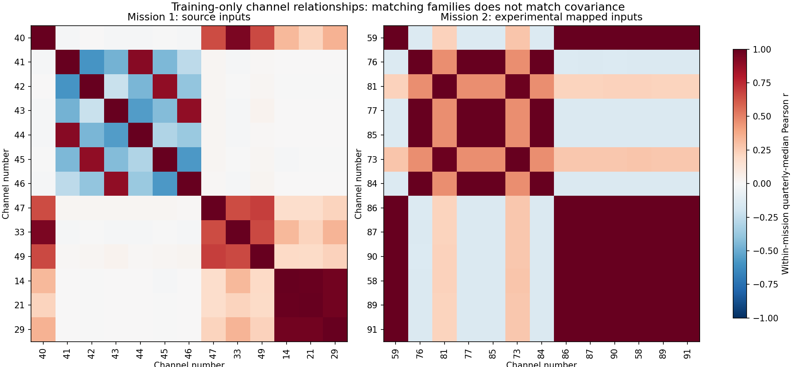

# Mission1/Mission2 channel research and new whole-system study

**Status,21 November2026,08:59 CET:** all nine Mission2 runs completed
training/calibration across the three techniques and all three seeds (9/18 overall).
Mission1 training has started: short-no-roll seed42 is at epoch2/40.
Completed-artifact hashes and frozen-source checks pass, with no v2
failures or restarts observed. The203-test suite and GPU preflight passed. V1 is
preserved after failing preparation with0/18 runs started; its service is disabled.
No new assessment results exist. See the
[approved v2 protocol](cross-mission-whole-system-protocol-v2-2026-11-20.md).
The completed channel research remains descriptive training-only evidence.

The old Mission2 experiment had a major input-coverage limitation. Its8-channel
base and11-channel expansion contained annotations for only14 of198 training
events, including1 of21 anomalies. Even all22 target channels in the two families
shared with the historical Mission1 inputs cover only19 of198 training events.
These findings support broader mission-specific inputs for whole-system monitoring.
They do not prove that channel coverage is the only cause of poor detection.

## What we can establish about physical meaning

The [dataset authors](https://arxiv.org/pdf/2406.17826), Supplementary2.3–2.4,
explicitly anonymize channel names, subsystems and physical units. Anonymous
subsystem/unit names are consistent across missions, but channel numbers are not
sensor identities. Each mission's time axis is independently shifted and scaled;
values are normalized within channel groups. Therefore, the public release does
not establish which of our channels measure temperature, electrical power or
another physical quantity. We cannot responsibly recover those names from signal
correlation alone. Anonymous groups remain useful for statistical modeling.

We retain the official [version1 dataset](https://zenodo.org/records/12528696)
used by the historical experiments. This investigation reverified all183 extracted
raw-channel/metadata hashes against the prior official-archive-verified receipt,
and both missions' saved training grids/matrices. This is scoped data integrity,
not a new certification of the full historical migration copy.

## Training-only investigation

We reviewed all176 channels' metadata/type/correlation inventory. Mission1 has58
target channels and Mission2 has47; each has13 target-channel groups. All targets
are numeric and nonconstant in the training inventory. Non-target counters,
categorical values and telecommands were not blindly interpreted as continuous
measurements. Nineteen Mission2 targets have no physical-unit entry.

All new channel choices use Mission1 2000–2005 and Mission2 2000 only. The existing
five-minute diagnostic grids use causal observations, at most600s old, with
per-channel nominal masks. Channel comparisons use quarterly standardized
quantiles, autocorrelations, change statistics, and within-mission signed level/
change relationships. A high correlation of levels alone is insufficient evidence
that channels share dynamics or anomaly relevance.

For the historical Mission1 inputs, metadata limits plausible Mission2 matches:

| Mission1 inputs | Anonymous family | Eligible Mission2 targets |
|---|---|---|
|40,47,33,49,14,21,29|subsystem6 / unit3|58,59,86,87,88,89,90,91|
|41–46|subsystem5 / unit4|70,71,72,73,75,76,77,78,79,80,81,83,84,85|

A deterministic one-to-one assignment accounts for both individual behavior and
channel relationships. It never duplicates a target channel or aligns anonymous
dates across missions. Its primary mapping is:

| Mission1 input | Experimental Mission2 input | Same match in four leave-season-out checks |
|---:|---:|---:|
|40|59|2/4|
|41|76|2/4|
|42|81|1/4|
|43|77|0/4|
|44|85|3/4|
|45|73|1/4|
|46|84|2/4|
|47|86|1/4|
|33|87|0/4|
|49|90|1/4|
|14|58|2/4|
|21|89|2/4|
|29|91|1/4|

**No channel match survives all four sensitivity checks.** Across the78 mapped
pairs, the mean absolute difference in quarterly-median level correlation is
0.403944; for change correlation it is0.158774. These are discrepancies, not
percentage similarity or probabilities. Matching group metadata and marginal
behavior has not recovered a stable physical or statistical equivalence.
The mapping is retained as a deliberately limited test of existing weights, not
as the input design for newly trained whole-system models.

## Broader panels for fresh training

Each mission's base panel selects one nominal-training medoid from every target
group. The expanded technique adds the most closely related change-behavior
companion from each nonsingleton group. No event-count ranking or assessment
score selected these channels. The expanded panels have25 and26 inputs.

| Mission | Base13 inputs | Additional expanded inputs |
|---|---|---|
|1|13,29,34,32,22,41,47,50,59,62,64,66,72|12,30,35,33,23,44,49,51,58,63,65,75|
|2|27,22,19,15,12,10,73,82,88,72,58,97,83|26,21,20,16,14,9,81,74,91,70,59,96,85|

The following counts are **training annotations represented on input channels,
not model detections or assessment results**:

| Mission / panel | Input count | Events represented (Anomaly+Rare) | Anomalies represented |
|---|---:|---:|---:|
|M1 historical40–47|8|46/95|21/55|
|M1 historical expanded+33/49|13|64/95|39/55|
|M1 new group representatives|13|65/95|39/55|
|M1 new representatives+companions|25|73/95|44/55|
|M2 historical base|8|14/198|1/21|
|M2 historical expanded|11|14/198|1/21|
|M2 new group representatives|13|192/198|16/21|
|M2 new representatives+companions|26|198/198|21/21|

This particularly improves Mission2's observed training coverage. It cannot
guarantee higher F0.5 or recall on future years. Mission1's panels still omit
direct annotations for some training events. All whole-system assessment events
remain in the denominator, including events outside the model's input channels.
These membership counts are not upper bounds on indirect detection.

## Authorized experiments and verification

The [execution protocol](cross-mission-whole-system-protocol-2026-11-18.md) fixes18
fresh runs: three techniques and three seeds per mission, trained separately.
Mission2 runs first. Forty epochs, batch32, same Transformer architecture and
learning settings, with raw causal preparation and training-only scaling. Whole-
system calibration replaces the old selected-eight calibration objective.
All18 choices freeze jointly before any new assessment preparation.

| Mission | Training | Calibration | Assessment |
|---|---|---|---|
|1|2000–2005|2006|2007–2013|
|2|2000|Jan–Sep2001|Oct2001–Jun2003|

Separately, all nine existing Mission1 context-arm models will be evaluated on
Mission2 under the fixed mapping, preserving weights and source decision rules.
Both unchanged source scaling and target-training normalization are predefined;
the latter is explicit target-data adaptation. Neither condition tunes on target
calibration/assessment or selects the best source seed. The source model's30s
cadence is retained; unknown physical time scaling remains a limitation.

Before launch,197 tests passed. Independent research replay checked5,600 profile
values, all five mapping objectives/constraints and24 coverage records. Synthetic
GPU preflight passed at batch32, peaking at2,194,147,840 allocated bytes for the
26-input short-no-roll model. The initial research script failed in annotation
coverage because of UTC-aware/naive timestamp comparison. That attempt and its
source are preserved; the fix changed the time comparison only, and all mapping
outputs matched exactly on rerun. No training or assessment occurred in that
failed attempt. Raw preparation is independently checked before neural training.

No new detection scores are reported here. Final reporting requires calibration
grid/selection replay, checkpoint inference spots, prediction/metric/ID verification,
all seeds and failures, and annual/pooled system and base scopes for both event
definitions. Historical comparisons are descriptive: input sets, causal preparation,
batch size, selection objective and score sources have changed. The assessment
benchmarks were already viewed, only three neural seeds are used, and additional
compute is required. No robust thesis-target or independent-generalization claim
is justified by this investigation.

## Preparation failure and decision pending on18 November

The service stopped at07:55:43 UTC on18 November with `No nominal training
windows` during independent Mission1 preflight. Mission2's training/calibration
source checks passed. The gate prevented all neural training; zero seeds failed
during learning because none started. The failure is in the preparation design:
Mission1 channels62/63 normally update every900s, while the frozen age limit is
600s. Each has zero complete256-sample windows. Enough isolated nominal rows do
not imply that the contiguous windows required by the model exist.

A training-only diagnostic independently reproduced the saved training mask and
used full pandas source lookup, including finite-value checks, for both slow
channels. Accepting readings for900s on these two inputs only produces349,383
nominal windows. This establishes feasibility, not detection quality or physical
validity of held measurements. All other input availability stays unchanged.

The [concrete amendment proposal](cross-mission-cadence-amendment-proposal-2026-11-18.md)
preserves v1 and requires explicit authorization for a separate version before
implementation. The active instruction prohibits changing frozen settings to
bypass failure. The service remains stopped while that decision is pending;
neither a restart nor a new experiment has been launched.

The13:36 UTC integrity recheck passed131 frozen source files, all183 raw files,
all five prepared split receipts and arrays, source/runtime/settings/selection,
and the installed service definition. The service has zero restarts and no live
runner. Available RAM, GPU memory and disk meet the frozen launch requirements;
the cause is the availability/window policy, not resource exhaustion.

Reproducible compact evidence is in
[tables/cross-mission-2026-11-18](tables/cross-mission-2026-11-18).
At that date the three-hour follow-up reported the stopped state and pending
decision. Completion cleanup had not occurred.

## Approved revision on20 November

The user subsequently explicitly approved the15-minute revision. The separate
[v2 execution protocol](cross-mission-whole-system-protocol-v2-2026-11-20.md)
changes maximum observation age to900s only for Mission1 channels62/63 in every
split. All other inputs retain600s, and all panels, mapping, seeds, learning
settings, splits and the joint18-selection gate are unchanged. This preserves
v1 as a failed preparation attempt rather than rewriting its specification.

Six new preparation tests cover finite-value and age boundaries, no cross-split
lookup, held anomaly exclusion only during training, unchanged sampling for all
other inputs and the unchanged job design. The full203-test suite passed17.000s;
synthetic GPU preflight again passed at batch32. All131 original frozen source
files, all five old prepared split receipts/arrays and the failure log verified.
The new133-file source inventory was frozen and backed up separately. These are
integrity/preparation checks, not detection scores.

Only esa-cross-mission-study-v2.service is enabled. It rebuilds training and
calibration arrays in results_longrun/cross_mission_transfer_20261120_v2, then
requires independent pandas source/mask/window/scaler checks before training.
The old failed service is disabled. Three-hour status reporting continues for
v2; the complete720-row independent assessment audit and publication remain
pending. Compact v2 provenance is under
[tables/cross-mission-2026-11-20-v2](tables/cross-mission-2026-11-20-v2).

V2 preparation passed583,991 sampled pandas raw-source/age/availability/mask
checks, all file hashes and full nominal-window/scaler checks. M1 has349,383
eligible windows, exactly matching the approved training-only diagnostic; M2
has98,224. The unchanged small-IQR fallback1 applies to M1channels64/65 and
M2channels27/26. This is recorded rather than changing scaling to improve results.
A separate full-array comparison confirmed byte-identical M2/transfer arrays,
unchanged M1 timestamps/ages and all other input values/availability, and gains
only for channels62/63 at ages>600s and<=900s. Panels/map and transfer scaling
are unchanged. Neural training started only after independent preparation passed.
At01:44 UTC one GPU worker was active with no v2 failure or restart, and the
first checkpoint recorded epoch1, batch700/3070. This is a dated progress snapshot,
not a completed experiment or a detection result.
