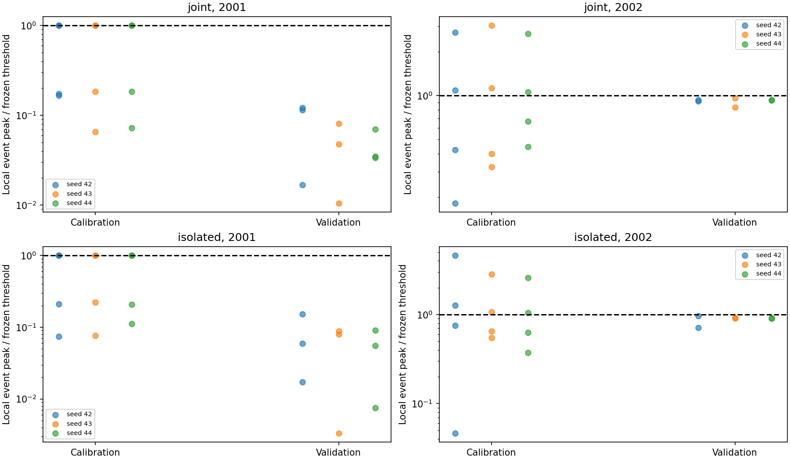
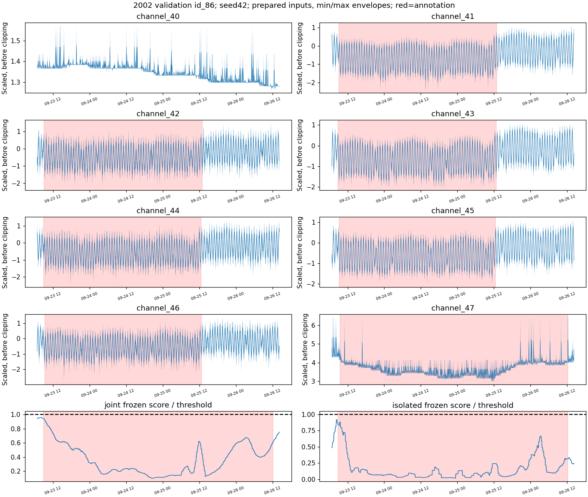

# Why calibration did not transfer: missed-event audit

## Conclusion

The internal failures are not explained by cross-channel interference alone.
Calibration selects alarms on a narrow subset of events. Later events can produce
much smaller scores, and in 2002 normal scores frequently exceed event peaks.
A lower global threshold is therefore not a sufficient general fix.

No model, threshold or prediction was changed. The audit covers the primary
calibration-selected joint and isolated models, both folds and all three seeds.
The periods remain previously inspected development data, not independent tests.

## Verified event comparison

Each fold has four local calibration IDs. Both architectures detect the same two
IDs in each fold for every seed: id_21/id_78 in 2001, id_83/id_84 in 2002. The
other two calibration IDs are already missed. Overlapping IDs do not necessarily
represent independent anomaly patterns.

| Real validation period | Local IDs | Joint event peak / threshold, all seeds | Isolated event peak / threshold, all seeds | Local IDs detected |
|---|---|---:|---:|---:|
| Jul–Dec 2001 | id_37, id_38, id_80 | 0.0105–0.1218 | 0.0033–0.1521 | 0 |
| Jul–Dec 2002 | id_25, id_86 | 0.8326–0.9632 | 0.7082–0.9640 | 0 |

The threshold is ratio 1. The 2001 event peaks are far below it. In 2002 they
approach it, but score ranking is poor: across each event/seed pair, **49.1–67.5%**
of nominal timestamps have joint scores at least as high as the local event's
peak. For isolated models the range is **11.7–68.4%**. These are six-month nominal
sample fractions, not false-event counts, operational alarm rates, or a proposed
new threshold evaluation. Nominal timestamps can include overlap-window spillover.

## Prepared inputs and clipping

Thirteen event plots show channels 40–47 around all local calibration and
validation IDs, plus both seed-42 frozen score traces. Values are scaled by the
saved training scaler **before** clipping; the actual model uses ±10 clipping.
Min/max envelopes retain short peaks when a long interval is compressed for
plotting. This is prepared telemetry, not a fresh audit of native raw files.

All five missed local validation IDs have zero clipping on their annotated input
channels. In contrast, calibration id_78 has an annotated-channel clipping
fraction up to 32.2%, and id_83 has an annotated channel clipped throughout its
own annotated interval. Detected id_21 overlaps id_78 but has no clipping within
its own annotated channel/time intervals; do not count their shared score peak
as two independent clipped-event signatures. Detected id_84 also has no clipping.
Thus calibration is not exclusively selecting clipped events, and clipping alone
does not explain the missed-event failures.

The v2 input statistics use each channel's own annotated intervals. The preserved
initial plots used ID-union intervals for clipping summaries; use **v2** for
channel-specific conclusions.

### Example: missed id_86 in September 2002

Annotated channels show level changes while oscillations continue. The frozen
score falls during much of the event, then rises toward the end. Both models
remain below their selected threshold. A rule that interprets only high absolute
reconstruction error as anomalous cannot exploit a downward score change.
This single example does not establish that all downward changes are anomalies.

## What remains unresolved

The saved score is a channel maximum after overlapping window-mean aggregation.
This audit cannot separate poor reconstruction discrimination from temporal
averaging effects; it does not prove that pointwise scoring would fix the issue.
Earlier paired full-period scoring already favored window-mean over pointwise
scoring, so repeating that change without a new reason is not justified.

The channel-47 level trend documented in the earlier replay helps explain high
normal scores, but this audit does not establish its physical cause or exclude
preprocessing effects in the original prepared dataset.

## Next targeted hypothesis

Before more training, test whether **changes relative to recent residual behavior**
provide a useful signal beyond absolute high error. A possible fixed-checkpoint
comparison is a two-sided, history-only score deviation: unusual upward or
downward movement relative to a rolling normal reference. This is a hypothesis,
not an implemented detector or demonstrated improvement.

Predeclare its history length, initialization, treatment of ongoing alarms,
threshold grid, calibration selection and original-score control before running
it. Choose no settings from the event examples above. Adaptive references may
absorb sustained anomalies and can add false alarms; both risks must be assessed.
Use identical real validation periods and both local/system metrics, with all
seeds. No per-year threshold tuning on validation and no new outer assessment.
Keep the full-period reference unchanged.

## Checks and artifacts

- All 12 completed-run manifests verified; 24 calibration/validation periods audited.
- Calibration F0.5 recomputed and saved validation masks reproduced exactly.
- Both annotation manifests matched historical hashes.
- Prepared CSV golden checksum verified before and after input plotting.
- Seven evaluator tests passed. No training or GitHub push.
- [Event-level diagnostic table](tables/inner-event-audit-2026-10-08/events.csv).
- [Period-level metrics](tables/inner-event-audit-2026-10-08/periods.csv).
- [Annotated-channel input ranges](tables/inner-event-inputs-2026-10-08-v2/event_input_ranges.csv).

### All event plots

- [2001_calibration_id_21](tables/inner-event-inputs-2026-10-08-v2/2001_calibration_id_21.png)
- [2001_calibration_id_77](tables/inner-event-inputs-2026-10-08-v2/2001_calibration_id_77.png)
- [2001_calibration_id_78](tables/inner-event-inputs-2026-10-08-v2/2001_calibration_id_78.png)
- [2001_calibration_id_79](tables/inner-event-inputs-2026-10-08-v2/2001_calibration_id_79.png)
- [2001_validation_id_37](tables/inner-event-inputs-2026-10-08-v2/2001_validation_id_37.png)
- [2001_validation_id_38](tables/inner-event-inputs-2026-10-08-v2/2001_validation_id_38.png)
- [2001_validation_id_80](tables/inner-event-inputs-2026-10-08-v2/2001_validation_id_80.png)
- [2002_calibration_id_81](tables/inner-event-inputs-2026-10-08-v2/2002_calibration_id_81.png)
- [2002_calibration_id_83](tables/inner-event-inputs-2026-10-08-v2/2002_calibration_id_83.png)
- [2002_calibration_id_84](tables/inner-event-inputs-2026-10-08-v2/2002_calibration_id_84.png)
- [2002_calibration_id_85](tables/inner-event-inputs-2026-10-08-v2/2002_calibration_id_85.png)
- [2002_validation_id_25](tables/inner-event-inputs-2026-10-08-v2/2002_validation_id_25.png)
- [2002_validation_id_86](tables/inner-event-inputs-2026-10-08-v2/2002_validation_id_86.png)
