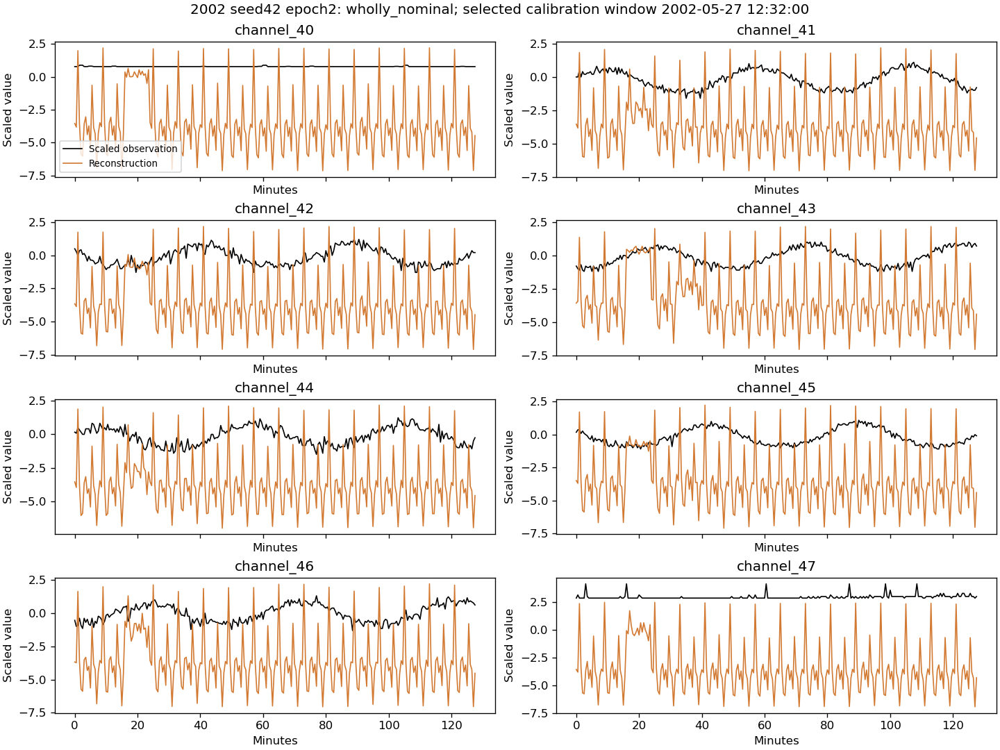

# Why the internal models fail: channel and calibration diagnosis

## Main finding

The saved models reconstruct some fully nominal patterns poorly, especially
channel47 in early2002. Calibration also emphasizes a few large, sometimes clipped
events while missing smaller ones. Checkpoint selection alone does not resolve
these problems. Retain the existing full-period baseline; this is a diagnosis of
the earlier internal pilot, not new assessment performance or a proven cause.

## Scope and verification

Replayed calibration-selected checkpoints for2001/2002 and seeds42/43/44 using
GPU, channels40–47. All six score arrays reproduce the original arrays exactly;
calibration F0.5 also matches. Training CSV golden hash verified before/after;
checkpoint, source and annotation hashes checked. Only each fold's training and
January–June calibration data were used; no internal-validation or outer-assessment
scores were read. Training probes contain256 nominal windows per training year.
Prepared CSV values are the unscaled inputs here; this is not a new native-telemetry
or physical subsystem interpretation.

## Normal reconstruction errors

Use **wholly nominal windows** for this comparison, not just nominal timestamps.
The scorer averages window errors over overlapping windows, so a nominal timestamp
can inherit error from a neighboring annotated anomaly. The initial diagnostic
v1 exposed this issue; v2 adds clean-window distributions and selects genuinely
nominal example windows. Both versions are preserved.

For channel47, compare window MSE with window MSE:

| 2002 seed | Training-sample q99 | Full clean calibration-window q99 | Channel47 share of largest1% clean-window scores |
| --- | ---: | ---: | ---: |
| 42 | 3.368 | 11.176 | 98% |
| 43 | 5.373 | 34.649 | 100% |
| 44 | 6.082 | 51.359 | 100% |

No nominal input values are clipped in these training/calibration intervals.
Selected fully nominal examples show reconstructions deviating substantially
from observations, including repeated output patterns shared across channels.
The examples were deliberately chosen for high error; they do not establish how
often this happens or prove architecture collapse. Sampled training versus full
calibration and dependent overlapping windows limit statistical interpretation.
The2001 winner pattern varies by seed; channel47 is not universally responsible.
Do not remove it: it also supplies useful real-event scores.

## Real anomalies are not equally visible

In2001 seed42, local events id_77 and id_79 reach only16.7% and17.3% of the frozen
threshold. Detected id_21/id_78 reach the extreme clipped region. In the plotted
id_21 window, channels41–47 sit at the scaler's+10 boundary. Those annotations
overlap in the example: two detected IDs are not two independent signal changes.

In2002 seed42, id_81 reaches42.5% of threshold and id_85 reaches18.2%, while
id_83/id_84 exceed it. Across all three seeds, id_81 and id_85 remain below the
threshold. Id_83 includes substantial clipping on its peak-scoring channel.
Clipping of anomalies and absence of nominal clipping are different findings.
Removing clipping is not automatically a fix: it could make extreme events
dominate the threshold still more.

## Numerical and alarm-cap limitations

At2001 seed42, increasing the saved threshold by four float32 spacing units
(about0.000061) changes calibration F0.5 from0.666667 to0. This is a numerical
sensitivity probe, not a selected alternative rule or a claim that the ESA
metric is incorrect. Other seeds are less sensitive; all2002 F0.5 values remain
unchanged under the tested ±8-unit perturbations.

The1% selection cap applies to **all alarm samples**, including alarms inside
true anomalies. It can reject useful detection of long anomalies. A diagnostic
re-ranking of the saved grid under a1% **nominal false-alarm-time** cap improves
calibration in two2001 seeds, but leaves seed43 and all2002 decisions unchanged.
For example seed42 moves from2 to4 detected calibration IDs with0 false events,
but alarms for5.0% of total time. This is calibration-only evidence, not a new
validation result. No cap, checkpoint or frozen threshold was changed. Because
this alternative leaves2002 unchanged, it is not a demonstrated general solution.

## One next experiment worth testing

Hypothesis: the artificial-anomaly separation penalty may encourage error
patterns that also affect unfamiliar normal windows. This is plausible from the
normal reconstruction examples, **not causally proven** by them.

Propose one bounded loss-weight ablation: keep normal reconstruction MSE weight1
and reduce the pseudo-anomaly penalty multiplier from1 to0.1. Preserve generator,
model, channels, scaler, window scoring, calibration policy, dates, seeds and
budget; compare matched arms on identical real validation periods. The0.1 value
is a predefined diagnostic reduction, not an optimized value. Keep all seeds and
report both scopes, false-event counts and false-alarm duration. This has not been
implemented or trained. Reuse verified control artifacts only if initialization,
data, sampling and all other protocol settings match exactly.

This differs from reconstruction-only training (penalty0), which was already
tested and did not consistently improve results. Do not repeat that experiment
unchanged or launch another architecture sweep. There is no promised F0.5 gain;
failure would be evidence against this loss-balance hypothesis.

## Artifacts

Script: `scripts/research/diagnose_inner_scores.py`.
Primary output: `results_longrun/diagnostics/inner_scores_v2`.
Compact tables, plots and verification: `tables/inner-score-diagnosis-2026-10-02/`.
Initial boundary-window observations and diagnostic sensitivity tables are in
`inner_scores_v1`; clean-window findings supersede its nominal-point examples.
No production model/evaluator changes, new training or GitHub push.
