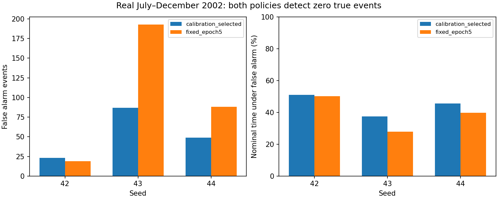

# Internal checkpoint-selection comparison: completed negative result

## Decision

Do not adopt fixed epoch5. The predefined advancement gate failed. Retain the
existing full-period baseline and selection policy. This experiment does not
replace its 2007–2013 results (system F0.5 0.805722, input scope 0.862907), and
does not establish that either method is robust. No outer assessment was rerun.

## Matched design

Six GPU training jobs: two chronological folds times seeds42/43/44. Inputs are
channels40–47, Transformer AE, short_no_roll augmentation, five epochs, 25,000
globally nominal training windows, batch64, float32. Each job produces one
training trajectory. Compare its calibration-selected epoch (earliest tie) with
epoch5, calibrating each with the same grid and 1% total-alarm cap. Both decisions
are frozen before internal validation. Validation uses real data only; synthetic
corruptions are used during training. Local and system scores share predictions.

| Fold | Training | Calibration | Internal validation |
| --- | --- | --- | --- |
| 2001 | 2000 | Jan–Jun2001 | Jul–Dec2001 |
| 2002 | 2000–2001 | Jan–Jun2002 | Jul–Dec2002 |

These are earlier internal development periods, not the existing 2003–2005 or
2007–2013 assessments. Earlier training cutoffs and six-month calibration differ
from the outer protocol. Historical data have informed this research; do not call
these pristine test results. The approved gate required higher mean system F0.5
in both folds and no mean false-event increase in either fold.

## Results

All means are across three seeds, not pooled event metrics.

| Real validation | Policy | Mean system F0.5 | Mean input-scope F0.5 | Mean TP IDs | Mean false alarm events |
| --- | --- | ---: | ---: | ---: | ---: |
| Jul–Dec2001 | Calibration-selected | 0 | 0 | 0 | 0 |
| Jul–Dec2001 | Fixed epoch5 | 0 | 0 | 0 | 0 |
| Jul–Dec2002 | Calibration-selected | 0 | 0 | 0 | 53 |
| Jul–Dec2002 | Fixed epoch5 | 0 | 0 | 0 | 100 |

All individual F0.5 values are zero, hence sample SD is also zero; this is
consistent failure, not evidence of useful robustness. In2001 each run misses
7 system IDs / 3 input-scope IDs and produces no alarms. In2002 each misses
3 system IDs / 2 input-scope IDs.

| 2002 seed | Selected epoch | Existing-policy FP | Epoch5 FP |
| --- | ---: | ---: | ---: |
| 42 | 2 | 23 | 19 |
| 43 | 1 | 87 | 193 |
| 44 | 1 | 49 | 88 |

False-alarm duration and count show a tradeoff: mean nominal false-alarm time
falls from44.7318% to39.2384% in2002, while event count rises. Neither policy
detects true validation events. The1% cap is a calibration constraint, not a
guarantee on future data. Quiet Q42002 is retained; it has zero selected events
and fixed-epoch nominal false-alarm rates of93.88%,52.09%,74.33% by seed. Its
event F0.5 is not an informative measure of detection ability.

## What the scores show

For2001, calibration F0.5 is0.666667 for both decisions across all seeds. The
existing policy chooses epoch1. Thresholds range184–196; validation score maxima
are only15–37, so no alarms occur. In2002, both decisions have calibration F0.5
0.769173 across seeds, yet no selected real validation event is detected.
Changing the checkpoint rule alone does not repair this transfer failure.

Nominal training/calibration monthly input summaries show no clipping under
either fold's training-fitted scaler. That check does not cover validation
clipping and does not rule out a change in normal operating patterns. These
observations do not prove which channel, preprocessing choice or physical
behavior caused the failure. Do not lower thresholds using these validation
results and report the same periods as independent evidence.

## Verification and artifacts

- All85 thesis tests passed, including full completed-campaign resume,
  interrupted-training equivalence, zero/tied selection, and freezing both
  policies before validation loading.
- Thirty saved epoch artifact hashes and calibration selections/scores checked.
- Twelve frozen validation masks exactly reproduced from saved scores/rules.
- All24 local/system metric rows reproduced within1e-9 with the corrected metric.
- Complete30-second validation timelines checked; source and annotation hashes
  still match the campaign protocol. Training CSV golden hash checked repeatedly
  during the campaign. No prior results or checkpoint rules overwritten.
- Active campaign: `results_longrun/development/inner_selection_cuda_v2`.
  Full execution log copied into that directory. CPUv1 and pretraining CUDAv1
  attempts are preserved and excluded.
- Verified tables, monthly calibration score summaries, quiet-quarter metrics,
  and plots: `tables/inner-selection-results-2026-10-02/`.
- Reproduction: `scripts/research/review_inner_validation.py --source
  results_longrun/development/inner_selection_cuda_v2 --output NEW_DIRECTORY`.

## Next research direction

Close this selection-policy ablation. Before further training, inspect raw and
scaled normal channel behavior and real-event reconstruction in the existing
training/calibration periods, with particular attention to whether score scales
are dominated by a few large deviations. This should test a specific scoring or
preprocessing hypothesis. Do not launch another architecture or threshold search
because this comparison failed. Future use of the internal validation outcomes
must be disclosed as development. No robust0.85 claim and no GitHub push.
