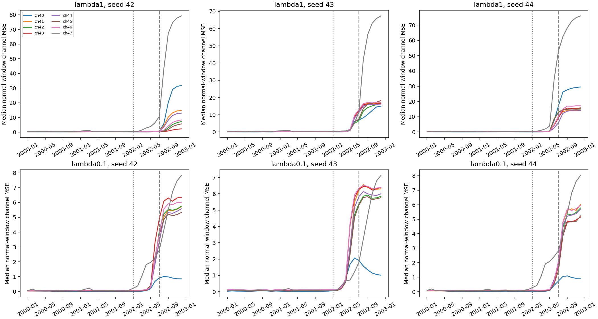

# Channel replay: why normal telemetry triggers alarms

## Conclusion

Channel 47's changing level and poor reconstruction are a major contributor to
the late-2002 score increase. The problem is broader than one channel: errors
also rise on other outputs. Reducing the artificial-anomaly loss weight reduces
error magnitudes but does not produce reliable separation from real anomalies.
Do not delete channel 47 or treat a higher threshold as a demonstrated solution.

## Evidence and method

We replayed all six selected 2002-fold models (weights 1 and 0.1, seeds 42–44).
All full July–December validation score arrays reproduced **exactly**, with
maximum absolute difference zero. Models, scalers and thresholds were frozen.
The prepared CSV checksum matched its golden value before and after replay.

A fixed sample of 128 evenly spaced windows per month covers January 2000 through
December 2002: 4,608 windows per model. Every 256-sample window is wholly nominal
across all prepared label channels and wholly inside its month. Sampling does
not depend on model errors. Training is 2000–2001, calibration January–June 2002,
validation July–December 2002. These are the small internal experiments, not the
full-period reference model.

Channel 47's mean scaled observation over sampled windows changes from **0.926**
in December 2001 to **3.292** in June 2002 and **4.842** in December 2002. This is
visible in the prepared input itself; no sampled channel values were clipped.
These are prepared telemetry values, not a physical interpretation of the sensor.

## December 2002 channel 47

| Loss weight | Seed | Mean scaled input | Mean reconstruction | Median window MSE | Windows where ch47 has largest error |
|---|---:|---:|---:|---:|---:|
| 1 | 42 | 4.842 | -3.780 | 79.241 | 100% |
| 1 | 43 | 4.842 | -3.306 | 67.376 | 100% |
| 1 | 44 | 4.842 | -3.826 | 76.048 | 100% |
| 0.1 | 42 | 4.842 | 2.155 | 7.821 | 93.75% |
| 0.1 | 43 | 4.842 | 2.221 | 7.128 | 70.31% |
| 0.1 | 44 | 4.842 | 2.096 | 8.020 | 92.19% |

MSE is mean squared reconstruction error. A channel's window MSE is not the
final overlapping, aggregated event score; the preceding temporal diagnosis
provides actual frozen alarm durations. Mean input/reconstruction differences
also do not capture all within-window error.

The reduced-weight models reconstruct this channel more closely, but their
calibrated thresholds differ: 6.183, 24.323 and 5.914 respectively. Seed 43's
silence is therefore not evidence of a superior reconstruction: it also misses
all three system events. Seeds 42 and 44 detect two events but produce prolonged
false alarms. Changing weight alone has not solved the problem.

## Broader behavior

The plots show rising errors across several outputs during 2002, including
channels whose input levels change less. A shared model may propagate a changing
input into other reconstructions, but this replay alone does not establish that
causal mechanism. A controlled input intervention would be needed to test it.
Channel 47 also carries real anomaly information in earlier diagnostics; its
high normal error is not a sufficient reason to remove it.

## Research decision

Keep the full-period reference unchanged. Do not launch another broad training
sweep. The next focused hypothesis is whether separating slow level changes
from short deviations can reduce normal reconstruction errors while preserving
real events. Before implementing a new detector, test this mechanism with the
saved model on training/calibration windows and review the earlier residual
Transformer failure to avoid repeating it. No improved F0.5 is claimed here.

This validation data has been inspected for development. Any subsequent method
informed by it must disclose that fact; no same-period score becomes independent
confirmation merely because a new model is used.

## Artifacts and checks

- [Monthly channel statistics](tables/loss-weight-channel-replay-2026-10-03/channel_monthly.csv)
- [Exact replay checks](tables/loss-weight-channel-replay-2026-10-03/replay.csv)
- [Provenance](tables/loss-weight-channel-replay-2026-10-03/verification.json)
- Full diagnostic artifacts: `results_longrun/diagnostics/loss_weight_channels_v1`.
- All 87 thesis tests passed. Source hashes and completed-run manifests verified.
- No training, threshold changes, outer assessment rerun or GitHub push.

Vertical dotted and dashed lines mark the start of calibration and validation.
Panels use different vertical scales; compare the numeric axes.

