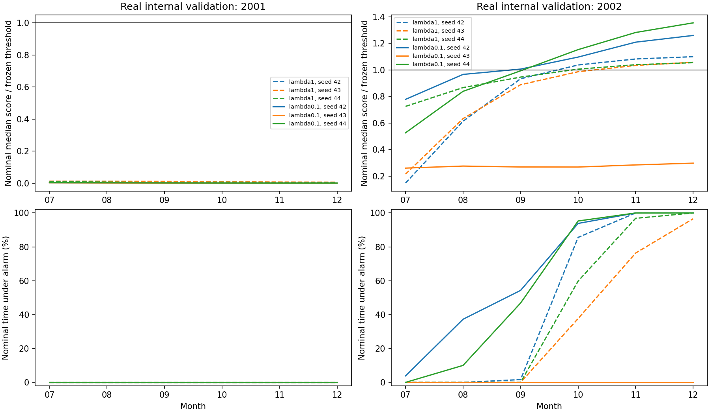

# Frozen loss-weight scores: temporal diagnosis

## Finding

The failed internal experiment has two distinct problems: thresholds suppress
all detections in 2001, while normal-period scores cross the frozen threshold
and produce prolonged alarms in late 2002. Lower training reconstruction error
alone did not fix either problem.

This read-only analysis uses all 12 primary runs (two loss weights, two folds,
three seeds), their saved aggregate scores and predictions, and raw annotations.
No training, checkpoint selection or threshold adjustment was performed. No
2003–2005 or 2007–2013 assessment was accessed.

## 2002: normal scores cross the threshold over time

For reduced weight 0.1, median nominal score divided by the frozen threshold is:

| Seed | July | September | December | November/December nominal time under alarm |
|---|---:|---:|---:|---:|
| 42 | 0.778 | 1.006 | 1.259 | 100% / 100% |
| 43 | 0.260 | 0.268 | 0.297 | 0% / 0% |
| 44 | 0.526 | 0.993 | 1.354 | 100% / 100% |

A ratio of 1 is the alarm threshold. Seeds 42 and 44 generate many separate
alarms while scores cross it, followed by nearly continuous alarms. One long
false alarm can count as just one false event while covering an entire month;
therefore false-event counts must be read alongside false-alarm duration.
The original weight also shows rising normal scores: December median ratios
are 1.099, 1.057 and 1.054 for seeds 42, 43 and 44 respectively.

Candidate seeds 42 and 44 detect event IDs id_25 and id_86, and miss id_7.
Seed 43 misses all three. Its calibrated threshold is 24.32 versus 6.18 and
5.91 for the other two seeds, but absolute thresholds cannot be compared alone
because each model produces its own score scale. Relative to its threshold,
even its strongest annotated event score reaches only 0.657.

## 2001: all event scores are below threshold

Across the original-weight runs, the largest sampled score within any selected
annotation interval is at most 0.122 times its run's threshold. For reduced
weight it is at most 0.0544. All seven system event IDs remain undetected in
every run. This is not a failure caused by alarm merging: all selected rules
use merge_gap=0 and min_dur=1.

## What this establishes, and what it does not

The evidence establishes temporal changes in the distribution of saved anomaly
scores relative to the calibration thresholds. It does not prove a physical
sensor drift, identify a faulty channel, or distinguish preprocessing effects
from model reconstruction behavior. These files contain only an aggregate
score; channel attribution requires replaying saved checkpoints with per-channel
residuals. Earlier channel-47 calibration findings cannot automatically be
extended to this later validation period.

Nominal means outside all annotation intervals. Scores at such timestamps may
still include windows overlapping nearby annotations. Monthly event counts are
computed on slices and must not be summed into pooled counts. In particular,
a continuous alarm crossing month boundaries appears in multiple slices.
These validation periods are now inspected development data, not untouched tests.

## Next bounded investigation

Replay saved selected checkpoints on a fixed sample of late-2002 nominal
windows to compare channel input values, scaled inputs, reconstructions and
per-channel errors against training/calibration references. Include the silent
seed 43 and original-weight controls. Use wholly nominal windows to avoid
annotation spillover. First establish whether input/preprocessing changes or
reconstruction behavior explain the rising scores; do not remove channels or
choose a new threshold from these validation results. Keep the main full-period
baseline unchanged.

## Verification and files

The diagnostic verified completion-manifest hashes for every primary run,
reconstructed each frozen prediction from scores and its saved rule, and
recomputed pooled system F0.5 within 1e-9 of the saved results.

- [Monthly scores and metrics](tables/loss-weight-diagnosis-2026-10-03/monthly.csv)
- [Event score ratios and detections](tables/loss-weight-diagnosis-2026-10-03/events.csv)
- [Frozen rules](tables/loss-weight-diagnosis-2026-10-03/frozen_rules.csv)
- [Verification and limitations](tables/loss-weight-diagnosis-2026-10-03/verification.json)



Reproduce with:

```bash
PYTHONPATH=. python scripts/research/diagnose_loss_weight_scores.py --output NEW_DIRECTORY
```
