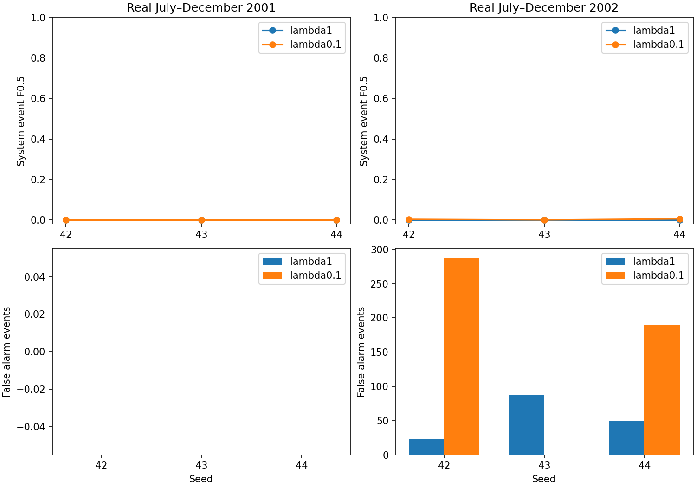

# Artificial-anomaly loss weight: completed comparison

## Conclusion

Reducing the artificial-anomaly penalty weight from 1 to 0.1 did not pass the
predeclared improvement rule. Keep the existing full-period reference. All six
candidate runs finished and their saved results were verified.

## What changed and why

We changed the training loss from `normal_MSE + pseudo_penalty` to
`normal_MSE + 0.1 * pseudo_penalty`. The hypothesis was that less pressure from
generated anomalies would improve reconstruction of normal telemetry and real
anomaly separation. Inputs remain channels 40–47. Architecture, corruption
generator, preprocessing, windows, seeds, five-epoch budget and calibration
selection were matched. Artificial anomalies occur only during training.

Each arm uses seeds 42, 43 and 44. For the 2001 fold, training uses 2000,
calibration January–June 2001, and validation July–December 2001. For the 2002
fold, training uses 2000–2001, calibration January–June 2002, and validation
July–December 2002. Both arms are evaluated on identical real telemetry.

## Primary results

Values are means across three seeds, using calibration-selected checkpoints.
F0.5 uses the corrected event evaluator with nominal-duration precision penalty.

| Real validation period | Weight | System F0.5 | Input-scope F0.5 | False events | System recall | Nominal false-alarm time |
|---|---:|---:|---:|---:|---:|---:|
| Jul–Dec 2001 | 1.0 | 0 | 0 | 0 | 0% | 0% |
| Jul–Dec 2001 | 0.1 | 0 | 0 | 0 | 0% | 0% |
| Jul–Dec 2002 | 1.0 | 0 | 0 | 53 | 0% | 44.73% |
| Jul–Dec 2002 | 0.1 | 0.002600 | 0.002601 | 159 | 44.44% | 43.07% |

System scope includes event IDs across all spacecraft channels; input scope
includes IDs annotated on channels 40–47. Both use the same eight-input model
and frozen predictions. Zero false alarms in 2001 means silence: all seven
system events and all three input-scope events were missed.

### Candidate variability in 2002

| Seed | System F0.5 | TP | FP | FN | Nominal false-alarm time |
|---|---:|---:|---:|---:|---:|
| 42 | 0.002787 | 2 | 287 | 1 | 67.75% |
| 43 | 0 | 0 | 0 | 3 | 0% |
| 44 | 0.005012 | 2 | 190 | 1 | 61.45% |

The small mean F0.5 increase is not a useful improvement. Two seeds detect real
events but produce extensive false alarms; the third detects nothing. The lower
mean false-alarm duration is partly explained by that silent third seed.

## Interpretation and decision

Normal training reconstruction improved: mean epoch-five normal MSE fell from
0.744388 to 0.087250 in the 2001 fold and from 0.658175 to 0.086263 in the 2002
fold. Better reconstruction on training data did not translate into reliable
real-event detection. This experiment does not establish that all smaller
penalties or other architectures would fail.

The predeclared gate required higher mean system F0.5 in both folds and no
increase in mean false-event count in either. It failed: 2001 tied and 2002
false events tripled. The runner also saved fixed-epoch-five results as a
secondary analysis; these were not used to change the primary selection policy.

No outer 2003–2005 or 2007–2013 assessment was rerun. The existing full-period
reference remains system F0.5 **0.8057**, input-scope **0.8629**, on 2007–2013.
Those scores are from a different protocol and period and must not be directly
compared with the internal scores above. The thesis target is not robustly met.
These internal periods have already informed development; they are not an
untouched final test.

## Verification and artifacts

- 87 thesis tests passed, including loss-weight handling and restoration.
- Candidate review recomputed 24 metric rows and checked 30 calibration epochs.
- Matched comparison checked source hashes, completion manifests, training
  windows, scalers, timestamps and 60 training-loss decompositions.
- [Protocol](loss-weight-comparison-2026-10-02.md).
- [All primary rows](tables/loss-weight-results-2026-10-03/results.csv).
- [Summary](tables/loss-weight-results-2026-10-03/summary.csv).
- [Training histories](tables/loss-weight-results-2026-10-03/training_history.csv).
- [Verification record](tables/loss-weight-results-2026-10-03/verification.json).

Candidate artifacts and execution log are preserved under
`results_longrun/development/inner_lambda01_cuda_v1`. No new training or GitHub
push was performed after this comparison. Before another training experiment,
the next useful step is to diagnose why normal and anomalous validation scores
remain poorly separated, keeping any resulting claims explicitly developmental.
