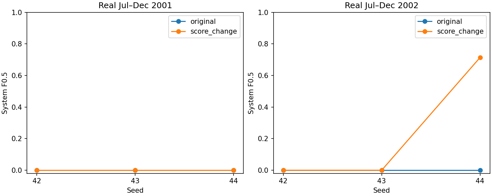

# Score-change pilot: verified result

## Decision

Do not adopt the candidate. The fixed score transform removes late-2002 false
alarms but does not recover events consistently across seeds or years. The
predeclared advancement gate failed. The main full-period reference is unchanged.

## Method

Reuse the six original joint-model calibration-selected checkpoints. Compare
original frozen scores with the absolute difference between log(1+score) and its
previous exponentially weighted mean, using a fixed one-day half-life. Carry
state from calibration into validation. Update the reference on every sample;
no label controls adaptation. No training, model selection, ensemble or channel
change. Calibrate thresholds/postprocessing on the original January–June periods
and assess identical real July–December periods. See the
[predeclared protocol](score-change-plan-2026-10-08.md).

## Mean over all three seeds

| Real validation | Method | System F0.5 | Input-scope F0.5 | Mean false events | Mean nominal false-alarm time |
|---|---|---:|---:|---:|---:|
| Jul–Dec 2001 | Original | 0 | 0 | 0 | 0% |
| Jul–Dec 2001 | Score change | 0 | 0 | 0 | 0% |
| Jul–Dec 2002 | Original | 0 | 0 | 53 | 44.73% |
| Jul–Dec 2002 | Score change | 0.238095 | 0.277778 | 0 | 0% |

The apparently improved 2002 mean is entirely due to seed 44 detecting **id_25**:
TP=1, FP=0, FN=2 system; system F0.5=0.714286, input-scope F0.5=0.833333.
Seeds 42 and 43 detect nothing. No seed detects id_86. All three miss every 2001
validation event. Zero false alarms therefore mostly reflects silence, not
successful anomaly detection. The target has not been robustly achieved.

The candidate's 2001 calibration F0.5 reaches 0.869467/0.666667/0.789365 across
seeds while validation stays zero. This again demonstrates that calibration
improvement alone is insufficient. We will not change the half-life or threshold
using these validation results to claim an independent improvement.

## Interpretation and limits

History-relative scoring addresses prolonged high-error alarms but does not
solve missed-event generalization. The hypothesis came from previously inspected
development data. The score transform is history-only, but the upstream AE uses
retrospective overlapping windows; this is not an operationally causal detector.
Separate calibration/validation score segments retain their upstream boundary
effects even though filter state is continuous. Adaptation can absorb sustained
anomalies. No new outer assessment was run.

Do not launch a full-period campaign for this candidate. Preserve this negative
result alongside the loss-weight and channel-isolation ablations. Before another
model sweep, a simple telemetry-based reference detector would help determine
whether the difficulty is specific to learned reconstruction scores. Such a
comparison needs its own fixed protocol and is not implemented by this report.

## Verification

All six source manifests and historical source/annotation hashes matched.
Each rule was persisted before loading that run's validation scores.
Original masks reproduce saved predictions. A separate reviewer reconstructs the
transform using pandas EWM rather than the SciPy filtering implementation; both
calibration and continuous validation scores match within 1e-10. All 24 paired
local/system metric rows were recomputed within 1e-9. Full suite: **95 tests
passed**, including prefix independence and split-stream equivalence.

- [All results](tables/score-change-results-2026-10-08/results.csv).
- [Summary](tables/score-change-results-2026-10-08/summary.csv).
- [Independent verification](tables/score-change-results-2026-10-08/independent_verification.json).
- Full artifacts: `results_longrun/development/score_change_v1`.

