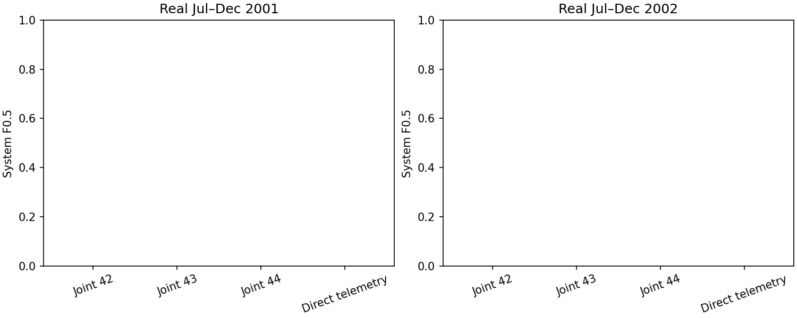

# Direct telemetry reference: completed result

## Decision

The reference detector failed the predeclared improvement rule. It generated no
validation alarms and missed every event in both internal periods. Do not adopt
it or extend it to the outer period. The main full-period baseline is unchanged.

## What was tested

Channels 40–47, existing prepared data, training-only median/IQR scaling and ±10
clipping. For each channel, absolute deviation from its previous exponentially
weighted mean (fixed one-day half-life), divided by its nominal-training deviation
q99 with a1e-6 floor. The maximum across channels is the score. Reference state
updates on every sample and carries through train/calibration/validation.

No neural training, channel removal, label-dependent reference updates or
validation tuning. The same threshold grid and1% calibration alarm cap are used.
This deterministic detector runs once per fold; it is compared with the three
saved joint Transformer runs, not artificially replicated as three seeds.
See the [predeclared protocol](telemetry-reference-plan-2026-10-08.md).

## Real-data results

| Validation period | Calibration system F0.5 | Validation system F0.5 | Validation input F0.5 | TP / FP / FN system | FN input scope |
|---|---:|---:|---:|---|---:|
| Jul–Dec 2001 | 0.666667 | 0 | 0 | 0 / 0 / 7 | 3 |
| Jul–Dec 2002 | 0.555556 | 0 | 0 | 0 / 0 / 3 | 2 |

Nominal false-alarm duration is zero in both periods, because the detector remains
silent. This is not a successful detection result. The joint Transformer also
has zero F0.5 in these internal comparisons; its 2002 mean false-event count is53
and mean nominal false-alarm duration fraction44.73%.

The frozen thresholds are7.722970 (2001) and8.967885 (2002), with merge_gap0 and
min_dur1. The maximum score over the **entire** validation period reaches only
39.59% and38.56% of its respective threshold. No alarm is being removed by
postprocessing; no raw score crosses the threshold.

## Interpretation

The inability to transfer the calibrated decision is not exclusive to the
Transformer reconstruction architecture: this direct-telemetry reference also
fails. This does not prove that the prepared data contains no usable signal,
that all statistical detectors fail, or that a lower threshold would generalize.
The reference uses only one fixed timescale and amplitude statistic; periodic
structure, operating modes and relational anomalies can require other features.

Do not adjust the half-life, quantile normalization or thresholds based on these
validation results and then call the same periods independent confirmation.
Before more model searches, review calibration representativeness and its
precision/recall trade-off using calibration data alone. The repeated high
calibration/zero-validation outcomes should be reported as a central limitation,
not hidden by selecting a favorable year or seed.

Score computation uses past observations, but prepared-data provenance and
postprocessing do not establish an operationally causal end-to-end detector.
These previously inspected internal years remain development data.

## Verification and artifacts

- Golden prepared CSV checksum verified before and after the run.
- Historical annotation hashes and all six Transformer run manifests verified.
- Training scalers match the Transformer controls; validation timestamps match.
- Independent pandas EWM reproduces all training/calibration/validation
  deviations within1e-9, including state continuation.
- Calibration rules reselected from saved grids; all four reference metric rows
  independently recomputed from saved predictions.
- Full suite: **98 tests passed**, including streaming equivalence, prefix
  independence, channel isolation and exclusion of annotations from scale fitting.
- No outer assessment, neural training, threshold revision or GitHub push.

[Detailed results](tables/telemetry-reference-results-2026-10-08/results.csv) ·
[Event outcomes](tables/telemetry-reference-results-2026-10-08/events.csv) ·
[Verification](tables/telemetry-reference-results-2026-10-08/metric_verification.json)

Full artifacts: `results_longrun/development/telemetry_reference_v1`.

